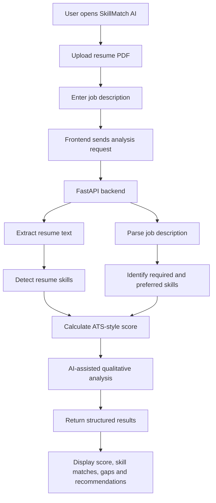
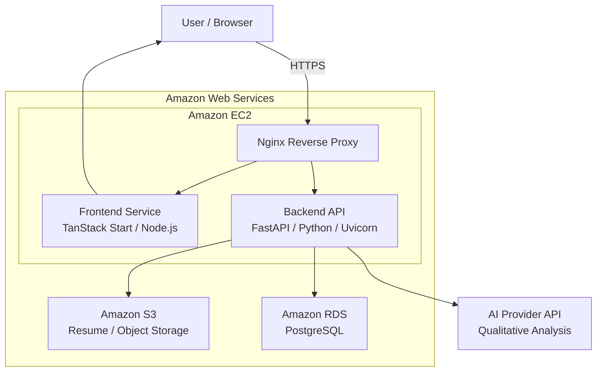

 <div align="center">

# SkillMatch AI

### Smarter Resume Analysis. Clearer Career Insights.

An AI-assisted resume analysis and job-matching platform that helps candidates understand how their resumes align with a target job description.

[](https://skillmatch-ai.online/)
[](https://aws.amazon.com/)
[](https://skillmatch-ai.online/)

**[Visit Live Website](https://skillmatch-ai.online/) · [Explore Repository](https://github.com/NayanGattani/skillmatch-ai) · [Report an Issue](https://github.com/NayanGattani/skillmatch-ai/issues)**

</div>

---

## Overview

**SkillMatch AI** is a full-stack resume analysis platform that evaluates a candidate's resume against a specific job description. It combines skill matching, ATS-style scoring, skill-gap identification, and AI-assisted qualitative recommendations to provide a more structured view of job fit.

The application is deployed on **Amazon Web Services (AWS)**, using an EC2-hosted application stack, Nginx as a reverse proxy, Amazon S3 for resume/object storage, and Amazon RDS for PostgreSQL persistence. The live website is available over HTTPS.

Rather than relying on a generic resume score, SkillMatch AI evaluates a resume in the context of a target role.

## Table of Contents

- [Features](#features)
- [Application Workflow](#application-workflow)
- [System Architecture](#system-architecture)
- [Technology Stack](#technology-stack)
- [ATS Scoring Logic](#ats-scoring-logic)
- [AWS Infrastructure](#aws-infrastructure)
- [Project Structure](#project-structure)
- [Run Locally](#run-locally)
- [Environment Configuration](#environment-configuration)
- [Security Considerations](#security-considerations)
- [Future Improvements](#future-improvements)
- [Screenshots](#screenshots)

---

## Features

| Feature | Description |
|---|---|
| **Resume Analysis** | Process an uploaded resume and extract relevant information. |
| **Job-Specific Matching** | Compare a resume against a particular job description. |
| **ATS-Style Scoring** | Calculate a compatibility score based on detected skill matches. |
| **Skill Extraction** | Identify relevant technical skills from the resume. |
| **Required vs. Preferred Skills** | Distinguish core requirements from additional desirable skills. |
| **Skill-Gap Analysis** | Highlight required and preferred skills not detected in the resume. |
| **AI-Assisted Recommendations** | Generate qualitative insights to help candidates improve their alignment with a role. |
| **AWS Object Storage** | Store resume objects using Amazon S3. |
| **Persistent Data Storage** | Use PostgreSQL hosted on Amazon RDS for application data. |
| **Secure Web Access** | Access the deployed application through HTTPS. |

---

## Application Workflow

The analysis process follows a structured pipeline, from document upload to presentation of results.



### Processing stages

1. **Input:** The user uploads a resume and supplies a job description.
2. **Document processing:** The backend extracts text from the PDF.
3. **Requirement analysis:** The job description is processed to identify skill requirements.
4. **Skill matching:** Skills detected in the resume are compared with the requirements.
5. **Scoring:** The scoring engine calculates an ATS-style compatibility score.
6. **AI analysis:** An AI API integration provides qualitative analysis and recommendations.
7. **Results:** The frontend presents the analysis in a structured interface.

The numeric score and AI-generated feedback serve different purposes. The score comes from the application's scoring logic; AI-generated insights supplement it with qualitative feedback.

---

## System Architecture

The application follows a frontend/backend architecture with AWS-managed storage and database services.

### High-level architecture



### Component responsibilities

| Component | Responsibility |
|---|---|
| **Frontend** | Collects user input and presents analysis results. |
| **Nginx** | Acts as the web entry point and routes requests to the application services. |
| **FastAPI** | Handles API requests and coordinates resume analysis. |
| **Amazon EC2** | Hosts the application services. |
| **Amazon S3** | Provides object storage for uploaded resumes. |
| **Amazon RDS for PostgreSQL** | Provides managed relational data persistence. |
| **AI API Integration** | Supports qualitative analysis and recommendations. |
| **HTTPS/TLS** | Encrypts traffic between the browser and the public website. |

The diagram represents the application's high-level deployment. It does not assume additional services such as ECS, Fargate, Lambda, API Gateway, or CloudFront unless they are separately configured.

---

## Technology Stack

### Frontend


### Backend and Data


### Cloud and Infrastructure


### Core technologies

| Technology | Purpose |
|---|---|
| React and TypeScript | Interactive frontend development |
| TanStack Start | Frontend application framework |
| Python and FastAPI | Backend API and analysis workflow |
| PDF processing | Text extraction from uploaded PDF resumes |
| PostgreSQL | Relational database |
| AI API integration | Qualitative resume and job-description analysis |
| Nginx | Reverse proxy and web entry point |
| systemd | Management of deployed application processes |
| AWS EC2 | Application hosting |
| Amazon S3 | Resume and object storage |
| Amazon RDS | Managed PostgreSQL database |

---

## ATS Scoring Logic

SkillMatch AI evaluates resume-to-job alignment using a weighted scoring approach that distinguishes between required and preferred skills.

- **Required skills:** Core requirements for the target role.
- **Preferred skills:** Additional desirable qualifications.
- **Matched skills:** Skills detected in the resume and included in the relevant job requirements.
- **Missing skills:** Requirements that were not detected in the resume.

Where the implementation uses a required-skill weight of `1.0` and a preferred-skill weight of `0.5`, the score is calculated as follows:

\[
\text{ATS Score} =
\frac{
(M_r \times 1.0) + (M_p \times 0.5)
}{
(T_r \times 1.0) + (T_p \times 0.5)
}
\times 100
\]

Where:

- \(M_r\) = matched required skills
- \(M_p\) = matched preferred skills
- \(T_r\) = total required skills
- \(T_p\) = total preferred skills

The result is expressed as a percentage.

### Important distinction

The ATS score is a deterministic, rule-based compatibility measure—not a trained model predicting whether a candidate will get hired. Skill detection can miss aliases, synonyms, or contextual meaning. AI-generated recommendations provide an additional qualitative layer rather than replacing the scoring calculation.

---

## AWS Infrastructure

The production application runs on AWS EC2, with Nginx serving as the public web entry point. Amazon S3 and Amazon RDS support storage and persistence.

### Amazon EC2 — Application Hosting

EC2 hosts the frontend and backend application services. This provides control over the runtime environment, application processes, and server configuration.

### Nginx — Reverse Proxy

Nginx receives incoming web traffic and routes requests to the relevant application service. It separates the public web entry point from the internal frontend and backend processes.

### Amazon S3 — Object Storage

S3 provides storage for resume objects, avoiding reliance on the EC2 filesystem as the only possible place for persistent document storage.

### Amazon RDS for PostgreSQL — Persistent Data

RDS provides a managed PostgreSQL database for structured application data, reducing the need to administer the database engine directly on the application server.

### HTTPS — Secure Website Access

The public website is available at [https://skillmatch-ai.online/](https://skillmatch-ai.online/). HTTPS encrypts traffic between the browser and the website.

### Request flow

1. The user visits the live website.
2. HTTPS traffic reaches the configured web entry point.
3. Nginx routes requests to the frontend or backend.
4. FastAPI coordinates the analysis workflow.
5. The backend interacts with the configured storage, database, and AI API services.
6. Structured results are returned for display.

AWS services are used according to their configured roles. Optional AWS services should not be assumed to be part of the deployment without corresponding configuration.

---

## Project Structure

The repository is organized around frontend and backend components. Exact paths may evolve as the codebase changes.

```text
skillmatch-ai/
├── frontend/
│   ├── src/
│   ├── public/
│   ├── package.json
│   └── ...
├── backend/
│   ├── app/
│   ├── requirements.txt
│   └── ...
├── .env.example
├── .gitignore
└── README.md
```

---

## Run Locally

### Prerequisites

- Git
- Node.js and npm
- Python 3
- Required application configuration and API credentials, where applicable

### 1. Clone the repository

```bash
git clone https://github.com/NayanGattani/skillmatch-ai.git
cd skillmatch-ai
```

### 2. Start the frontend

```bash
cd frontend
npm install
npm run dev
```

Open the local URL printed by the development server.

### 3. Start the backend

Open another terminal and navigate to the backend directory:

```bash
cd backend
python -m venv venv
```

Activate the virtual environment on Windows:

```powershell
.\venv\Scripts\Activate.ps1
```

On macOS or Linux:

```bash
source venv/bin/activate
```

Install the required Python dependencies:

```bash
pip install -r requirements.txt
```

Start FastAPI using the actual module path in the repository. For example, if `main.py` is in the current directory:

```bash
uvicorn main:app --reload
```

The API documentation is typically available at `/docs` on the local backend address when FastAPI's documentation endpoints are enabled.

**Note:** The exact commands and working directories should match the current frontend and backend configuration.

---

## Environment Configuration

Create a local environment file based on `.env.example` and the configuration required by the application.

Depending on the current implementation, configuration may include:

- Frontend API base URL
- Database connection details
- AI provider API key and model configuration
- AWS region and S3 bucket settings

Use the environment variable names expected by the actual code.

**Never commit credentials, database passwords, API keys, private keys, or other secrets to GitHub.** Keep local `.env` files out of version control and use appropriately scoped IAM roles for AWS access wherever possible.

---

## Security Considerations

Because resumes may contain personal information, appropriate access controls are important.

- Use HTTPS for public website access.
- Apply least-privilege permissions to AWS resources.
- Restrict database connectivity to the application components that require it.
- Keep uploaded resume objects private and protect access to them.
- Avoid logging sensitive resume contents or credentials.
- Store API keys and database passwords outside the source repository.
- Define retention and deletion policies for uploaded files and associated records.

These are important operational practices; the actual controls in place depend on the deployment configuration.

---

## Future Improvements

Potential enhancements include:

- More robust skill aliases, synonyms, and contextual matching
- OCR support for scanned resumes
- Improved job-description section parsing
- User accounts and saved analysis history
- Automated deployment and testing pipelines
- Expanded monitoring and operational alerts
- More extensive security and performance testing

These are potential improvements, not claims that the features are already implemented.

---

## Screenshots

### Resume Analysis


### Job Matching Results


### Dashboard


---

<div align="center">

### SkillMatch AI

Resume analysis and job matching, deployed on AWS.

**[Open the Live Website](https://skillmatch-ai.online/)**

[GitHub Repository](https://github.com/NayanGattani/skillmatch-ai) · [Report an Issue](https://github.com/NayanGattani/skillmatch-ai/issues)

</div>
